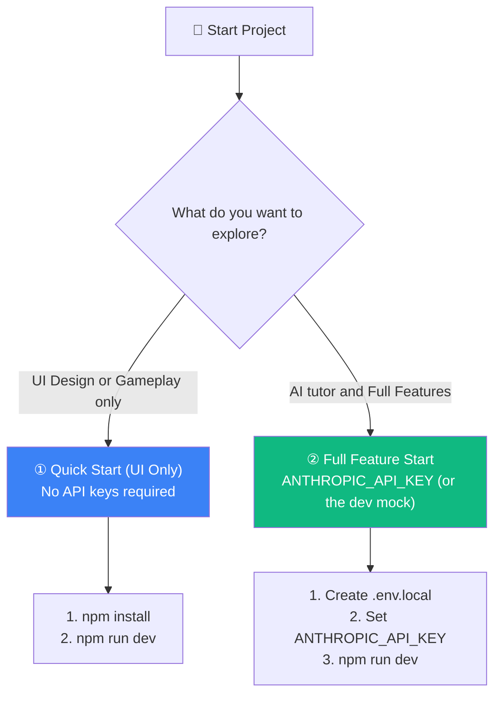

<div align="center">


# Rise Path Learning Platform
### The Next-Gen Immersive Learning Experience

**English** | [日本語](README.ja.md)
</div>

<br/>

**Rise Path** is a modern, experimental learning platform designed to revolutionize how we learn engineering, creativity, and languages. Unlike traditional LMS, Rise Path focuses on **"Vibe"**—the feeling of flow, immersion, and narrative-driven education.

## 🌟 Key Features

### 1. **AI-Powered Personalized Curriculums** ✨
Experience learning tailored just for you.
- **Big5 Personality Integration**: AI dynamically adapts curriculum content, tone, and learning style based on your Big5 personality traits.
- **Rich Content Generation**: Lessons go beyond summaries, providing 'Why It Matters', 'Key Concepts', 'Action Steps', and 'Analogies'.
- **AI Models**: Claude through the server-side LLM gateway (`server/llm/`). The tutor, writing feedback and course generation run on the cheap Claude model (Claude Haiku) by default. Gemini is off unless `GEMINI_ALLOWED=true` (see below).
- **RAG (Retrieval-Augmented Generation)**: Integrates with specific knowledge domains (like Blender documentation) to ground AI responses.

### 2. **Immersive Audio Experience (In Progress)** 🎧
- **Kokoro TTS**: Local ONNX narration via [Kokoro-82M](https://huggingface.co/hexgrad/Kokoro-82M) (replacing legacy gTTS and Gemini Native TTS).
- **Character-Driven**: Japanese/English voice selection (`jf_alpha`, `af_bella`, etc.) matched to the AI tutor persona (Rise Path / Lumina).

### 3. **P-School: Block Programming Battle** ⚔️
- **Gamified Coding**: Learn programming logic by battling monsters using Scratch-style blocks.
- **Phaser 3 Engine**: Real-time 2D RPG battles integrated directly into the React application.
- **Progressive Difficulty**: 20+ stages teaching loops, variables, functions, and logic.

### 4. **Diverse Learning Paths** 🗺️
- **Vibe Coding Path**: Narrative-driven coding (Prompt Engineering, Git) set in a sci-fi universe.
- **Dev Campus**: Web Basics (React/TS) and Gen AI application development.
- **3D Creative Lab**: Blender 3D modeling and sculpting.
- **Art Atelier**: Art History and Design Philosophy.
- **Global Communication**: English for global engineers.

### 5. **MCP Server — AI アシスタント連携** 🔌
Claude Code・Cursor など、自分のパソコンで動く AI から Rise Path のツールを使えます。
- **MCP ツール**: 公開レッスンを AI と学ぶツール（答えなしで読む・答え合わせ・進み具合。`course-*`）、学習進捗・ジャーナル・カリキュラム生成・教材づくり・RAG 検索など（一覧は `mcp-server/tool-registry.json`）
- **Transport**: stdio（ローカル）。SSE は開発のときと、VM の中（Hermes や、Tailscale 経由の運用者）だけで使います。インターネットには公開しません
- **リモートの AI（ChatGPT、Claude.ai など）**: 18 歳以上の学習者が、学習者ごとの OAuth でつなぎます（Phase 1。運営者の公開の手順は [`doc/guides/byoa-setup.ja.md`](doc/guides/byoa-setup.ja.md)）。ブリッジトークン（`RISE_PATH_BRIDGE_TOKEN`）を外部のサービスに渡さないでください
- **ヘルスチェック & Graceful Shutdown**: 本番運用対応

> 📘 **[使い方ガイド（詳細）](doc/guides/usage_guide.md)** — Web アプリ・MCP・カリキュラム作成の完全ガイド

---

## 📖 Lessons: Reader, Format and Authoring

### Lesson reader
- Every lesson opens in one reader at **`/learn/:course/:lesson`** (for example `/learn/vibe-coding/vibe-ch1`): an outline on the left, the AI tutor and glossary in the margin, inline checks while you read, flashcards and a wrap-up at the end. Progress is saved per lesson, and the dashboard's "Continue" card resumes it.
- On phones the outline, AI tutor and practice move to a bottom bar. The **Aa** menu sets text size, line spacing, theme, a UD reading font and focus mode.
- Dev builds add **`/preview/:course/:lesson`** (prefers the draft and shows the validation report) and **`/dev/blocks?dev=1`** (every block type).

### Lesson format (`risepath.lesson/v1`)
- Lessons are JSON files: `content/courses/<slug>/course.json` plus `lessons/<id>.lesson.json`. Drafts live in `drafts/` and only appear in previews.
- One definition: `shared/lesson/schema.js` (zod), used by the reader, the server, the MCP tools and the CLIs. JSON Schema exports live in `content/schema/`.
- A lesson has 2–4 objectives with Bloom levels and sections with roles (hook → concept → example → practice → check → summary), built from 15 block types (markdown, callout, table, code, prompt, mermaid diagram, quiz, flashcards, steps, …).

```bash
npm run lessons:catalog                       # courses and lessons with their status
npm run lessons:validate                      # schema + semantic checks (errors carry JSON paths)
npm run lessons:lint -- <file> --strict       # pedagogy and readability rules
npm run lessons:preview -- vibe-coding vibe-ch1   # screenshots + metrics.json (dev server running)
```

### Authoring with Claude Code and other agents
- **Claude Code**: `/author-lesson <course> <lesson-id> "<brief>"` runs brief → outline → draft → validate and lint → independent review (`pedagogy-reviewer`, `ja-editor`) → screenshots and `visual-qa` → report. Drafts only; the owner publishes. `/review-lesson <file>` reviews any lesson against `content/schema/rubric.v1.json`.
- **MCP**: `.mcp.json` registers the `rise-path-learning` server with the `curriculum-builder` profile (`lesson-schema-get`, `lesson-validate`, `lesson-get`, `lesson-upsert-draft`, `lesson-preview-url`). Codex, Cursor, Gemini CLI, Claude Desktop and ChatGPT can use the same tools; `AGENTS.md` holds the shared rules.
- Guide: **[doc/guides/authoring-with-claude-code.ja.md](doc/guides/authoring-with-claude-code.ja.md)** (Japanese) · [English summary](doc/guides/authoring-with-claude-code.md)

---

## 🛠 Tech Stack

- **Frontend**: [React](https://react.dev/) (v19) + [Vite](https://vitejs.dev/)
- **Language**: [TypeScript](https://www.typescriptlang.org/)
- **AI/LLM**: [Claude API](https://platform.claude.com/) via `@anthropic-ai/sdk` behind the server gateway; Gemini (`@google/genai`) only on deployments with `GEMINI_ALLOWED=true`
- **Game Engine**: [Phaser 3](https://phaser.io/) (v3.80)
- **Visual Coding**: [Blockly](https://developers.google.com/blockly) / Scratch Blocks
- **Backend/Service**: Node.js (Express) for local proxying and audio handling.
- **Styling**: [Tailwind CSS](https://tailwindcss.com/)
- **State/Routing**: React Context + Custom View-based routing.

---

## 🚀 Getting Started for Engineers

### Quick Start (UI Only)
If you want to explore the UI without wiring the full backend, you can run the frontend only:

```bash
npm install
npm run dev
# Frontend: http://localhost:3007
```

You can browse most screens without any key. The in-lesson AI tutor, writing feedback and course generation run on Claude through the server's LLM gateway (`ANTHROPIC_API_KEY`; a built-in mock answers in development when no key is set); the browser never calls a model API directly. The shared Hermes chat (the floating AI coach and `/life-journal/chat`) is not offered to learners: it appears only with `VITE_FEATURE_AGENT_CHAT=true` and a running Hermes, for self-hosting or development.

### 🏁 Choose Your Setup Mode

Depending on your goals, you can start the platform in two ways:



---

### 📋 Prerequisites

| Required Environment | Recommended Version | Note |
|---|---|---|
| **Node.js** | `v20.0.0` or higher | Required for development & build |
| **npm** | `v10.0.0` or higher | Package management |
| **Local LLM (Hermes)** | Any | Optional. Only for the shared Hermes chat (self-hosting or development, with `VITE_FEATURE_AGENT_CHAT=true`) |

---

### ⚙️ Environment Configuration (`.env.local`)

Create a [**`.env.local`**](.env.local) file in the root directory to store your environment variables:

| Variable Name | Default Value | Description | Importance |
|---|---|---|---|
| `ANTHROPIC_API_KEY` | (blank) | Server-side key for the LLM gateway (tutor, writing feedback, course generation). Without it, a mock answers in development | **Recommended** (in-app AI) |
| `VITE_FEATURE_AGENT_CHAT` | (blank = off) | Exactly `true` shows the shared Hermes chat (floating AI coach, `/life-journal/chat`) and lets the API serve `/api/v2/agent/chat`. Not offered to learners | Optional (self-hosting / development) |
| `HERMES_API_URL` | `http://127.0.0.1:8642` | Connection URL for your local LLM proxy (Hermes) | Optional (with `VITE_FEATURE_AGENT_CHAT=true`) |
| `HERMES_API_KEY` | `change-me-local-dev` | Bearer authorization token for Hermes | Optional (with `VITE_FEATURE_AGENT_CHAT=true`) |
| `GEMINI_ALLOWED` | (blank = off) | `true` turns Gemini on. Only for deployments that people under 18 cannot reach (see below) | Optional |
| `GEMINI_API_KEY` | (blank) | Server-side Gemini key (gateway, RAG embeddings, image generation); used only with `GEMINI_ALLOWED=true` | Optional |

```env
# LLM gateway keys (server only)
# ANTHROPIC_API_KEY=
# GEMINI_ALLOWED and GEMINI_API_KEY: only for deployments that people under 18 cannot reach
# GEMINI_API_KEY=

# Optional, self-hosting or development only: the shared Hermes chat
# VITE_FEATURE_AGENT_CHAT=true
# HERMES_API_URL=http://127.0.0.1:8642
# HERMES_API_KEY=change-me-local-dev
```

> [!WARNING]
> **Security Reminder**:
> `.env.local` might contain sensitive API keys. Never commit it to git (already added to `.gitignore`).

### 🤖 LLM gateway (`/api/v2/llm`)

Every model call goes through the server gateway in `server/llm/`; the browser never holds a model key. **Never put keys in `VITE_*` variables**: every `VITE_*` value is shipped to the browser. Model IDs live only in `server/llm/models.config.js`. Without any key, the gateway answers from a built-in mock outside production (and returns 503 in production unless `LLM_PROVIDER=mock`).

| Variable | Description |
|---|---|
| `ANTHROPIC_API_KEY` | Enables the Anthropic provider (the default for every task) |
| `GEMINI_ALLOWED` | Gemini (chat, RAG embeddings, image generation) is used only when this is exactly `true`. Unset or anything else is off, even when a Gemini key is set (the server logs a warning). Only for deployments that people under 18 cannot reach |
| `GEMINI_API_KEY` (or `GOOGLE_API_KEY`) | Enables the Gemini provider, RAG embeddings and image generation when `GEMINI_ALLOWED=true` |
| `LLM_PROVIDER` | Forces every task onto one provider: `anthropic`, `gemini` or `mock` |
| `LLM_TASK_<TASK>` | Per-task route, `provider[:model]`, e.g. `LLM_TASK_TUTOR_CHAT=anthropic:claude-sonnet-5-5` |
| `LLM_MOCK_FALLBACK` | `false` turns off the mock fallback when the routed provider has no key |
| `LLM_TIMEOUT_MS` | Request timeout (default 120000) |
| `LLM_MAX_RETRIES` | SDK retry count for provider calls |
| `LLM_ANTHROPIC_SERVER_FALLBACKS` | `false` disables Anthropic server-side model fallbacks |
| `ANTHROPIC_BASE_URL` | Alternative Anthropic endpoint (proxy or gateway) |

`GET /api/v2/llm/status` shows the active providers and task routes without secrets.

**Default models.** The AI tutor (`tutor.chat`), writing feedback (`writing.feedback`) and course generation (`course.generate`, `/api/v2/ai/generate`) run on the cheap Claude model (Claude Haiku), within the daily caps in `server/middleware/dailyCaps.js`. To move one back to the larger model, set for example `LLM_TASK_TUTOR_CHAT=anthropic:claude-sonnet-5-5` (likewise `LLM_TASK_WRITING_FEEDBACK`, `LLM_TASK_COURSE_GENERATE`).

**Why Gemini is off by default.** The [Gemini API Additional Terms](https://ai.google.dev/gemini-api/terms) forbid using the API in a service "directed towards or is likely to be accessed by individuals under the age of 18", and minors use Rise Path. So Gemini is used only when `GEMINI_ALLOWED=true`. With it off, uploaded materials are stored without vectors and found by keyword search (`node scripts/rag/reembed.mjs` embeds them later, once Gemini is allowed), and `/api/v2/image` answers 503 with `error_type: image_generation_unavailable`.

---

### 🚀 Setup Steps

#### 1. Clone the repository
```bash
git clone https://github.com/NPO-OpenCoralNetwork/rise-path-demo-game-integration.git
cd rise-path-demo-game-integration
```

#### 2. Install dependencies
```bash
npm install
```

#### 3. Run the development server
```bash
npm run dev
```
Once started, open your browser and navigate to [**`http://localhost:3007`**](http://localhost:3007) to explore the UI and play P-School coding battles!

#### 4. Checks before a pull request (CI)
GitHub Actions ([`.github/workflows/ci.yml`](.github/workflows/ci.yml)) runs these on every pull request and on every push to `main`:
```bash
npm run typecheck
npm test
npm run lessons:validate
npm run lessons:lint -- --strict
npm run lessons:schema -- --check
node .claude/skills/author-lesson/scripts/build-references.mjs --check
```
It also builds the production bundle (`npm run build:prod`) with dummy values in every model and service key, and fails if any of them appears in the output.


---

## 📂 Project Structure

```
/
├── components/          # React Components
│   ├── common/          # Shared UI (Layouts, Buttons, Modals)
│   ├── features/        # Feature-specific components
│       ├── ai/          # AI Course Generator, Chat, Character Views
│       ├── dashboard/   # Main Dashboard & Learning Hub
│       ├── PSchool/     # Block Programming Game (Phaser + Blockly)
│       └── ...          # Other domain views
├── context/             # Global Contexts (Theme, etc.)
├── public/              # Static assets
├── server/              # Node.js Express Backend
│   ├── graph/           # LangGraph Multi-Agent Workflows
│   ├── geminiBackendService.js # Gemini image generation (/api/v2/image)
│   ├── ragService.js    # RAG Ingestion & Retrieval
│   └── jobWorker.js     # Async Job Queue Worker
├── scripts/             # Utility scripts (Seeding, Migrations)
├── services/            # Frontend API Clients
├── server.js            # Main Server Entry Point
└── types.ts             # Global TypeScript definitions
```

---

## 🚧 Current Development Focus & Roadmap

We have successfully migrated to a **LangGraph-based Multi-Agent Backend**.

### Completed Features
- **LangGraph Integration**: State-driven workflow for "Requirements -> Roadmap -> Curriculum" generation with user approval loops.
- **RAG Architecture**: Document ingestion (PDF/Txt), chunking with `RecursiveCharacterTextSplitter`, and vector search using `pgvector`.
- **Async Job Worker**: Scalable background processing for document embedding.
- **Real AI Generation**: Each stage is one call to the server LLM gateway (task `course.generate`, the cheap Claude model by default).
- **Database Persistence**: Full state synchronization with PostgreSQL.

### Active Issues
- **Issue #3**: **Kokoro TTS Implementation**
  - Goal: Replace `gTTS` / `gemini_tts_node.js` with Kokoro-82M ONNX sidecar (`KOKORO_TTS_URL`).
- **Issue #4**: **Voice Selection Feature**
  - Goal: Allow users to select Kokoro `voice_id` personalities (e.g. `jf_alpha`, `jf_tebukuro`, `af_bella`).

### How to Contribute
1. Check the [Issues](https://github.com/NPO-OpenCoralNetwork/rise-path-demo-game-integration/issues) tab. Report security problems privately instead ([SECURITY.md](SECURITY.md)).
2. Create a feature branch from `main` (example: `feat/your-topic`).
3. Keep commits scoped and descriptive.
4. Follow the project's coding style (Functional React components, TypeScript, Tailwind).

### Collaboration Tips
- **Keys & secrets**: Keep keys in `.env.local` on the server side; never in `VITE_*` variables, localStorage or commits.
- **Large files**: Avoid committing large binaries (PDFs, datasets) unless agreed.
- **Demo vs full stack**: UI-only is fine for quick reviews; full stack is needed for AI generation flows.

### Optional: Full Stack (Advanced)
If you need the full AI generation flow with backend + database, you’ll need:
- `ANTHROPIC_API_KEY` set in `.env.local` (without a key, a built-in mock answers outside production)
- PostgreSQL with `pgvector`
- DB schema + seed scripts (see `doc/ai-curriculum-spec/local_postgres_phase1.sql` and `scripts/`)

---

<div align="center">
  <sub>Built with ❤️ by the Rise Path Team</sub>
</div>
