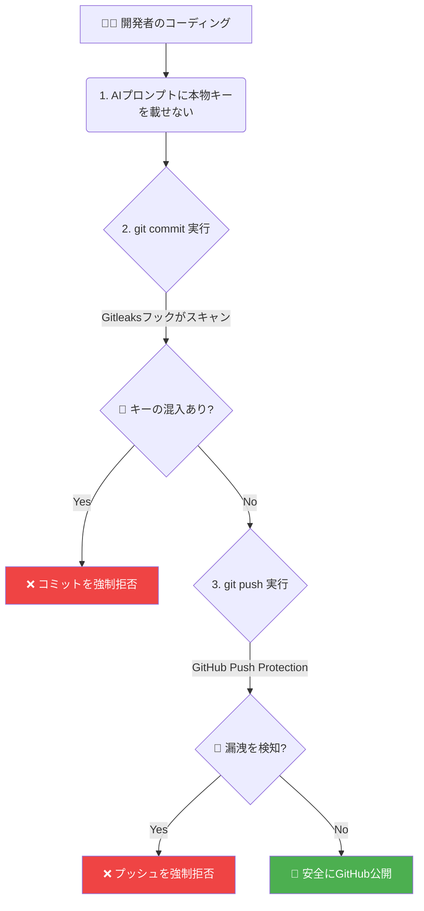

# 🔒 セキュリティガイドライン & 漏洩防止ガードレール

本ドキュメントは、P-School リポジトリをパブリック（OSS）として公開・運用するにあたり、APIキーやトークンなどの機密情報（Secrets）の漏洩を未然に防ぐためのセキュリティ方針と、開発環境へ導入すべき「自動ガードレール」の設定手順を定義したものです。

---

## 1. セキュリティ基本方針

Vibe Coding（AI主導の高速開発）では、AIによって機密情報が予期せずコード内にハードコードされるリスクが急増します。チーム全員が以下の原則を厳守してください。

### 🚨 3大原則
1.  **AIには「キーの型」を教え、「本物の値」は絶対に教えない。**
    - プロンプト内で直接本物のAPIキーを渡さない。常に環境変数（`process.env.XXX`）から読み込むコードを書かせる。
2.  **機密情報は `.env.local` のみで管理し、絶対にGit追跡対象に含めない。**
    - リポジトリにコミットして良いのは、キー名のみを記載した `env.local.template` や `.env.example` のみ。
3.  **「ローカルでのコミット前」および「GitHubへのプッシュ時」の2重ガードレールで検知を自動化する。**
    - 人間のコードレビューだけに頼らず、システムによって強制的にブロックする仕組みを導入する。

---

## 2. 🛡️ 4つのセキュリティガードレール導入手順

漏洩を水際で防ぐため、以下の自動検知・ブロック機能を導入します。



### ガードレール①：Gitleaks によるコミット前自動スキャン（Pre-commit）

ローカル環境で `git commit` コマンドを実行した瞬間に、コミットしようとしている差分にAPIキーが含まれていないかを自動スキャンし、検知した場合はコミットを強制キャンセルします。

#### 設定手順（各開発者のローカルで実行）

1.  **`pre-commit` フレームワークのインストール**:
    ```bash
    brew install pre-commit
    ```
2.  **設定ファイル `.pre-commit-config.yaml` の作成**:
    プロジェクトルートに以下のファイルを配置します。
    ```yaml
    repos:
      - repo: https://github.com/gitleaks/gitleaks
        rev: v8.30.1 # 最新の安定バージョンを指定（2026-10-28 時点）
        hooks:
          - id: gitleaks
    ```
3.  **Gitフックの有効化**:
    ```bash
    pre-commit install
    ```
    *※これにより、次回以降の `git commit` 時に自動で Gitleaks スキャンが走り、キーが含まれているとコミットがブロックされます。*
    *※Gitleaks の既定のルール（v8.30.1）には、Figma（`figd_`）・OpenRouter（`sk-or-v1-`）・Cloudflare Tunnel のトークンの形がありません。この 3 つは、ガードレール④の CI が確かめます。*

---

### ガードレール②：GitHub Push Protection（プッシュ保護）とリポジトリの設定

Gitleaksフックを回避してローカルでコミットされてしまった場合でも、GitHubへ `git push` するタイミングでGitHubのサーバーが検知し、プッシュを拒否します。公開リポジトリでは、GitHub の秘密の検出（secret scanning）は無料です。

#### 設定手順（リポジトリ管理者）

GitHub のリポジトリの **Settings** を開き、左のメニューの「**Security and quality**」の **Advanced Security** を選びます（画面の名前は、2026-10-28 に GitHub のドキュメントの原稿で確かめました）。

1.  「**Secret Protection**」が有効でなければ、右の **Enable** を押し、確認の画面で **Enable Secret Protection** を押します（秘密の検出と、その通知）。
2.  「Secret Protection」の中の「**Push protection**」の右の **Enable** を押します。
3.  「**Private vulnerability reporting**」の右の **Enable** を押します。[`SECURITY.md`](../../SECURITY.md) が案内する、非公開の報告の窓口です（公開リポジトリだけで使えます）。
4.  「**Dependabot alerts**」の右の **Enable** を押します。使っている npm のパッケージに脆弱性が見つかると知らせます（コードは変えません）。
5.  （任意）「**Code Security**」の「**CodeQL analysis**」の **Set up** から **Default** を選び、**Enable CodeQL** を押します。コードの自動の点検で、プルリクエストにチェックが増えます（必須のチェックには入れません）。

> [!IMPORTANT]
> **Push Protection が有効な場合**:
> 誤ってAPIキーを含んだコミットをプッシュしようとすると、ターミナル上にエラーメッセージが表示され、プッシュがブロックされます。開発者は、鍵を消して履歴を直し（`git commit --amend` 等）、プッシュし直します。理由を選んでブロックを迂回することもできますが、迂回するとアラートが残ります。本物の鍵では迂回しません。迂回のアラートが本物の鍵なら、管理者は下の「万が一…」の手順で無効にします。

---

### ガードレール③：プロンプトエンジニアリングの徹底

AIアシスタントにコーディングを指示する際、プロンプトの最後に以下の制約を必ず付与します。

> [!TIP]
> **コピペ用：AIへの指示制約文テンプレート**
> ```text
> 【制約事項】
> - APIキー、アクセスキー、パスワードなどの認証情報は絶対にハードコードしないでください。
> - 機密情報はすべて `.env.local` から環境変数（process.env.XXXX）経由で読み込む実装にしてください。
> ```

---

### ガードレール④：CI の確かめ（プルリクエストと main への push）

`.github/workflows/ci.yml` が、変わったファイルを `scripts/ci/scan-secrets.mjs` で確かめ、次の鍵か、個人の絶対パスを見つけると失敗します。値は伏せて出します。

- Google（`AIza`）、Anthropic（`sk-ant-`）、OpenAI（`sk-proj-` など）、OpenRouter（`sk-or-v1-`）、GitHub（`ghp_` など）、Slack（`xoxb-` など）、Figma（`figd_`）、Stripe（`sk_live_` など）、Cloudflare Tunnel のトークン、秘密鍵（PEM）、Supabase の `service_role` の JWT

全部のファイルを手元で確かめるときは、`node scripts/ci/scan-secrets.mjs --all` を流します。同じ CI の `Build and key-leak scan` は、本番のビルドにサーバーの鍵が入っていないことを確かめます。

CI は、GitHub に push したあとに動きます。このリポジトリは公開なので、CI が見つけた値が本物の鍵なら、もう公開されています（ブランチと、プルリクエストの参照 `refs/pull/…`）。値を消すコミットや amend の前に、下の「万が一…」の 1（無効化）から始めます。push の前に `node scripts/ci/scan-secrets.mjs --diff origin/main` を流すと、コミット前の変更と、まだ追跡していないファイルも同じように確かめられます。

---

## 3. プルリクエスト（PR）コードレビュー時のチェックリスト

PR統合時の人間の目によるレビューでは、以下の観点を確認してください。

*   [ ] 差分コード内に `figd_` (Figma), `AIzaSy` (Gemini/GCP), `eyJ` (JWT/Supabase) などの典型的なシークレットの文字列パターンが紛れ込んでいないか。ガードレール④の種類は CI が確かめるので、それ以外の鍵と、パスワードの入った接続文字列（`postgresql://ユーザー:パスワード@…`）を目で確かめます。
*   [ ] 新たに追加された設定用ファイル（`.env` やバックアップ用の `.bak` 等）が、誤ってコミット対象になっていないか（`.gitignore` に記述されているか）。
*   [ ] テスト用・デバッグ用として一時的に書き込んだ検証用キーが残ったままになっていないか。

---

## 🚨 万が一、機密情報をプッシュしてしまった場合の対応手順

自動ガードレールをすり抜け、万が一パブリックリポジトリにAPIキーが公開されてしまった場合は、**1秒でも早く**以下の手順を実施してください。

1.  **キーの無効化・失効（最優先）**:
    - 対象のサービス（Figma, Google Cloud, Supabase等）の管理画面にアクセスし、漏洩したキーを直ちに**削除・無効化**してください。
    - *※Gitの履歴から削除するよりも、キーそのものを失効させる方が圧倒的に早くて安全です。*
2.  **新キーの発行とローカル差し替え**:
    - 新しいキーを生成し、ローカルの `.env.local` のみを更新します。
3.  **履歴の抹消（必要に応じて）**:
    - コミット履歴からキーの文字列を完全に消去したい場合は、`git-filter-repo` を使って履歴の書き換えを行います。
    - *※書き換えには force push が要るので、オーナーが決めます（`AGENTS.md`）。公開リポジトリでは、書き換えても、プルリクエストの参照（`refs/pull/…`）や、だれかの複製に残ります。1 の無効化が先です。無効にした鍵は、履歴に残っても使えません。*
